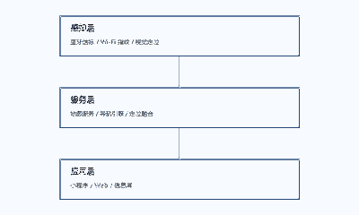

# 项目概述

本项目面向高校校园场景，设计并实现一套基于位置的智能导览系统。系统融合室内外定位、路径规划与多媒体呈现，为新生和访客提供一站式校园导航服务。

## 项目背景

随着高校校区面积不断扩大、建筑功能日趋复杂，新生与访客普遍存在找路困难的问题。传统地图应用在校园场景下精度不足，且缺乏针对校园服务的深度整合。

**痛点总结**：校园道路变化频繁、室内定位缺失、导览信息分散。

### 现有方案分析

目前市面上的方案主要包括三类：

- 通用地图应用：覆盖室外，但室内与校园定制能力弱
- 校园 App：信息集中，但地图能力与交互体验参差
- 静态导览图：制作成本低，但无法实时更新与个性化

#### 定位差异

本项目聚焦"校园场景的最后一公里"，以低成本硬件实现可运营的室内外一体化导览服务。

## 项目目标

系统整体架构如下图所示。



整体分为感知层、服务层与应用层三层结构。

## 项目创新点

### 低成本室内定位

利用蓝牙信标阵列与行人航迹推算融合，将部署成本降低至传统方案的 30% 以下。

#### 精度指标

- 走廊场景平均定位误差小于 1.5 米
  - 开阔区域误差更小
  - 高密度信标部署
- 大厅场景小于 3 米

# 技术方案

## 总体设计

系统采用前后端分离架构，开发流程如下：

1. 需求分析与数据采集
2. 定位算法与地图服务开发
3. 应用层联调与部署

```python
def hello():
    print("示例代码块")
```

## 功能模块

表：核心功能模块对比

| 模块 | 功能 | 技术选型 |
| --- | --- | --- |
| 地图服务 | 室内外地图渲染 | WebGL |
| 导航引擎 | 跨楼层路径规划 | 分层 A* |
| 定位融合 | 蓝牙 + 航迹推算 | 卡尔曼滤波 |

### 地图服务

提供室内外一体化地图渲染。

### 导航引擎

基于分层路网实现跨楼层路径规划。

## 部署方案

采用容器化部署，支持单机与集群两种模式。
